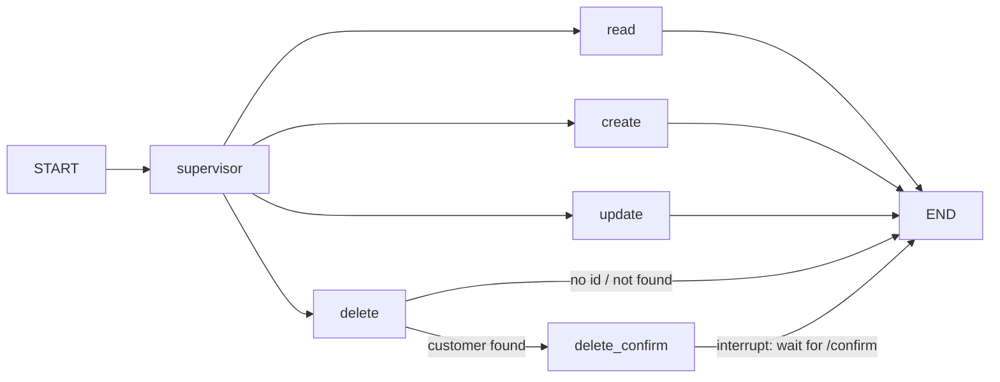

# 06 · Customer CRUD Multi-Agent API

A FastAPI service where a **supervisor** routes plain-English requests to specialised **read**, **create** and **update** agents, plus a **delete** flow that always pauses for confirmation. It can be plugged into Microsoft Foundry (or any OpenAPI-aware agent) as a tool.

## Database setup (Supabase)

1. Open your project in the [Supabase Dashboard](https://supabase.com/dashboard) → **SQL Editor** → **New query**.
2. Paste the SQL from each step below, in order, and click **Run**. "Success. No rows returned" means it worked.
3. Run the verify query at the end.

All statements are idempotent (`if not exists`, `on conflict do nothing`), so running them twice never duplicates data. The same SQL is part of [`supabase/schema.sql`](../supabase/schema.sql), which sets up **all six modules at once**; if you have already run that, skip this section.

This module only uses the shared `customers` table (plus `orders`, so customers with orders can't be deleted).

**Step 1: shared tables** (`customers`, `products`, `orders`). Skip if you already created them for another module; re-running is harmless.

<details>
<summary>Show SQL: shared tables + sample data</summary>

```sql
create table if not exists customers (
    id bigint generated by default as identity primary key,
    name text not null,
    city text not null,
    email text
);
alter table customers add column if not exists plan text not null default 'basic';
alter table customers add column if not exists created_at timestamptz not null default now();
create unique index if not exists customers_email_key on customers (email);

insert into customers (name, city, email, plan) values
    ('Rahul',  'Delhi',     'rahul@example.com',  'premium'),
    ('Priya',  'Mumbai',    'priya@example.com',  'basic'),
    ('Amit',   'Pune',      'amit@example.com',   'basic'),
    ('Sneha',  'Bengaluru', 'sneha@example.com',  'premium'),
    ('Vikram', 'Chennai',   'vikram@example.com', 'enterprise'),
    ('Ananya', 'Hyderabad', 'ananya@example.com', 'basic'),
    ('Karan',  'Delhi',     'karan@example.com',  'premium'),
    ('Meera',  'Kolkata',   'meera@example.com',  'basic')
on conflict (email) do update set plan = excluded.plan;

create table if not exists products (
    id bigint generated by default as identity primary key,
    sku text not null unique,
    name text not null,
    category text not null,
    price numeric(10, 2) not null
);

insert into products (sku, name, category, price) values
    ('SW-X1',    'SmartWatch X1',               'Wearables',   4999),
    ('EB-PRO',   'Wireless Earbuds Pro',        'Audio',       2999),
    ('SPK-MINI', 'Bluetooth Speaker Mini',      'Audio',       1999),
    ('LS-STD',   'Laptop Stand',                'Accessories', 1499),
    ('HUB-7',    'USB-C Hub 7-in-1',            'Accessories', 2499),
    ('NC-HP',    'Noise Cancelling Headphones', 'Audio',       8999),
    ('FB-LITE',  'Fitness Band Lite',           'Wearables',   1799),
    ('KB-MECH',  'Mechanical Keyboard',         'Accessories', 3999)
on conflict (sku) do nothing;

create table if not exists orders (
    id bigint generated by default as identity primary key,
    order_number text not null unique,
    customer_id bigint not null references customers (id),
    product_id bigint not null references products (id),
    quantity int not null check (quantity > 0),
    total numeric(10, 2) not null,
    status text not null check (status in ('placed', 'shipped', 'delivered', 'cancelled', 'returned')),
    order_date date not null
);

-- Orders are inserted by email / SKU so the ids resolve correctly in any database.
insert into orders (order_number, customer_id, product_id, quantity, total, status, order_date)
select v.order_number, c.id, p.id, v.qty, p.price * v.qty, v.status, v.order_date::date
from (values
    ('ORD-1001', 'rahul@example.com',  'SW-X1',    1, 'delivered', '2026-08-02'),
    ('ORD-1002', 'priya@example.com',  'EB-PRO',   1, 'delivered', '2026-09-28'),
    ('ORD-1003', 'amit@example.com',   'HUB-7',    2, 'delivered', '2026-08-15'),
    ('ORD-1004', 'sneha@example.com',  'NC-HP',    1, 'delivered', '2026-09-05'),
    ('ORD-1005', 'amit@example.com',   'KB-MECH',  1, 'delivered', '2026-10-01'),
    ('ORD-1006', 'vikram@example.com', 'LS-STD',   5, 'delivered', '2026-08-20'),
    ('ORD-1007', 'ananya@example.com', 'FB-LITE',  1, 'cancelled', '2026-09-12'),
    ('ORD-1008', 'karan@example.com',  'SPK-MINI', 2, 'delivered', '2026-09-18'),
    ('ORD-1009', 'rahul@example.com',  'NC-HP',    1, 'shipped',   '2026-10-14'),
    ('ORD-1010', 'meera@example.com',  'EB-PRO',   1, 'delivered', '2026-08-25'),
    ('ORD-1011', 'vikram@example.com', 'SW-X1',    3, 'placed',    '2026-10-18'),
    ('ORD-1012', 'meera@example.com',  'NC-HP',    1, 'delivered', '2026-10-06'),
    ('ORD-1013', 'sneha@example.com',  'FB-LITE',  2, 'returned',  '2026-08-10'),
    ('ORD-1014', 'karan@example.com',  'KB-MECH',  1, 'shipped',   '2026-10-16'),
    ('ORD-1015', 'priya@example.com',  'SPK-MINI', 1, 'placed',    '2026-10-19')
) as v (order_number, email, sku, qty, status, order_date)
join customers c on c.email = v.email
join products p on p.sku = v.sku
on conflict (order_number) do nothing;

alter table customers enable row level security;
alter table products  enable row level security;
alter table orders    enable row level security;
```

</details>

**Verify:** run this query; you should see `customers` 8, `products` 8, `orders` 15.

```sql
select 'customers' as table_name, count(*) as row_count from customers
union all select 'products' as table_name, count(*) as row_count from products
union all select 'orders' as table_name, count(*) as row_count from orders;
```

<!-- supabase-snapshot:start -->

### See it in Supabase

After running the SQL above:

1. **Create:** left sidebar → **SQL Editor** (`>_` icon) → **New query** → paste the SQL → **Run** (or Ctrl+Enter).
2. **Check:** left sidebar → **Database** → **Tables**, schema **public**. You should see this module's tables: `customers`.
3. **Browse data:** click a table (or open **Table Editor**, the grid icon) to see its rows; **View columns** lists the column types.

> The dashboard shows rows because you are logged in as the project owner. Row Level Security still blocks the public (anon) key.


<sub>Tables `chat_messages` … `fin_accounts`</sub>


<sub>Tables `hr_policies` … `ticket_events` (19 tables in total; `students` is unrelated to this repo)</sub>

### Table snapshot

Generated from the live database with `python supabase/snapshot_readmes.py`.

#### `customers` · 8 rows

| Column | Type | Notes |
|--------|------|-------|
| `id` | bigint | PK, auto id |
| `name` | text | required |
| `city` | text | required |
| `email` | text | unique |
| `plan` | text | default `'basic'::text`, required |
| `created_at` | timestamp with time zone | default `now()`, required |

Sample rows:

| id | name | city | email | plan |
|---|---|---|---|---|
| 1 | Rahul | Delhi | rahul@example.com | premium |
| 2 | Priya | Mumbai | priya@example.com | basic |
| 5 | Amit | Pune | amit@example.com | basic |

<!-- supabase-snapshot:end -->

## Graph



- Each agent is a `create_agent` ReAct agent that can only use its own tool.
- Deleting is **not** an LLM tool. The `delete` node finds the customer (regex first, LLM fallback), then `delete_confirm` calls `interrupt()`. Nothing is deleted until a separate `/confirm` call resumes the graph with `true`.

## Run

```bash
cd 06_customer_crud_multiagent
uvicorn main:app --port 8006
```

Open http://127.0.0.1:8006/docs, or use the terminal client in a second terminal:

```bash
python client.py "show all customers"
python client.py           # interactive; asks y/N before deletes
```

## API

| Endpoint | Body | Purpose |
|----------|------|---------|
| `POST /ask` | `{"message": "Show customers from Delhi"}` | Run the graph. Returns `status: done` with `result`, or `status: needs_confirmation` with a `thread_id` |
| `POST /confirm` | `{"thread_id": "...", "confirm": true}` | Resume a pending delete |
| `GET /health` | | `{"status": "ok"}` |

Optional settings in the repo-root `.env`:

| Variable | Effect |
|----------|--------|
| `API_KEY` | Every request must send header `X-API-Key: <value>` (click **Authorize** in `/docs`) |
| `PUBLIC_URL` | Added to the OpenAPI `servers` list, e.g. an ngrok URL |

## Use it as a Microsoft Foundry tool

1. Expose the API: `ngrok http 8006`, then set `PUBLIC_URL` to the ngrok URL and `API_KEY` to a long random string. Restart uvicorn.
2. In Foundry: **Management center → Connected resources → New connection → Custom keys**. Key name `X-API-Key`, value = your `API_KEY`.
3. Add an **OpenAPI tool** to your agent, paste `<PUBLIC_URL>/openapi.json`, and choose that connection for authentication.
4. Add to the agent's instructions: *"For deletes, show the confirmation question and call confirmDelete only after the user says yes."*

## Try these

```
Show all customers                -> note the ids
Show customers from Delhi
Add a customer named Ravi in Jaipur with email ravi@example.com
Change customer 5's city to Mumbai
Upgrade customer 8 to the premium plan
Delete customer <Ravi's id>       -> asks for confirmation, then deletes
Delete customer 1                 -> refused: Rahul has orders
```

Customers with orders, tickets or accounts can't be deleted (foreign keys); the API explains this instead of failing. Ids are not always consecutive, so list customers first.
