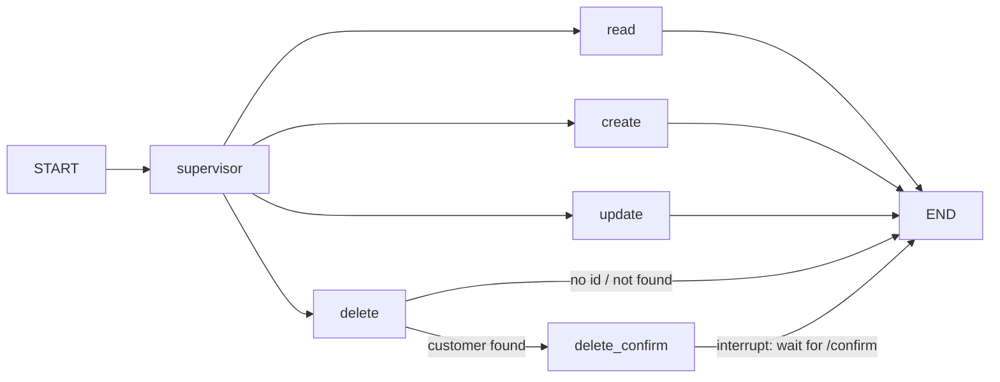

# 06 · Customer CRUD Multi-Agent API

A FastAPI service where a **supervisor** routes plain-English requests to specialised **read**, **create** and **update** agents, plus a **delete** flow that always pauses for confirmation. It can be plugged into Microsoft Foundry (or any OpenAPI-aware agent) as a tool.

## Graph



- Each agent is a `create_agent` ReAct agent that can only use its own tool.
- Deleting is **not** an LLM tool. The `delete` node finds the customer (regex first, LLM fallback), then `delete_confirm` calls `interrupt()`. Nothing is deleted until a separate `/confirm` call resumes the graph with `true`.

## Run

```bash
cd 06_customer_crud_multiagent
uvicorn main:app --port 8006
```

Open http://127.0.0.1:8006/docs, or use the terminal client in a second terminal:

```bash
python client.py "show all customers"
python client.py           # interactive; asks y/N before deletes
```

## API

| Endpoint | Body | Purpose |
|----------|------|---------|
| `POST /ask` | `{"message": "Show customers from Delhi"}` | Run the graph. Returns `status: done` with `result`, or `status: needs_confirmation` with a `thread_id` |
| `POST /confirm` | `{"thread_id": "...", "confirm": true}` | Resume a pending delete |
| `GET /health` | | `{"status": "ok"}` |

Optional settings in the repo-root `.env`:

| Variable | Effect |
|----------|--------|
| `API_KEY` | Every request must send header `X-API-Key: <value>` (click **Authorize** in `/docs`) |
| `PUBLIC_URL` | Added to the OpenAPI `servers` list, e.g. an ngrok URL |

## Use it as a Microsoft Foundry tool

1. Expose the API: `ngrok http 8006`, then set `PUBLIC_URL` to the ngrok URL and `API_KEY` to a long random string. Restart uvicorn.
2. In Foundry: **Management center → Connected resources → New connection → Custom keys**. Key name `X-API-Key`, value = your `API_KEY`.
3. Add an **OpenAPI tool** to your agent, paste `<PUBLIC_URL>/openapi.json`, and choose that connection for authentication.
4. Add to the agent's instructions: *"For deletes, show the confirmation question and call confirmDelete only after the user says yes."*

## Try these

```
Show all customers                -> note the ids
Show customers from Delhi
Add a customer named Ravi in Jaipur with email ravi@example.com
Change customer 5's city to Mumbai
Upgrade customer 8 to the premium plan
Delete customer <Ravi's id>       -> asks for confirmation, then deletes
Delete customer 1                 -> refused: Rahul has orders
```

Customers with orders, tickets or accounts can't be deleted (foreign keys); the API explains this instead of failing. Ids are not always consecutive, so list customers first.
